<div align="center">

# Clean &amp; Bliss

### Vitrine e-commerce **headless** — Next.js 16 × WordPress / WooCommerce

<p>
  <em>Parfumerie fine, bougies artisanales, senteurs d'ambiance et soins de la maison.<br/>
  Conçu et développé à Cotonou, Bénin.</em>
</p>

<p>
  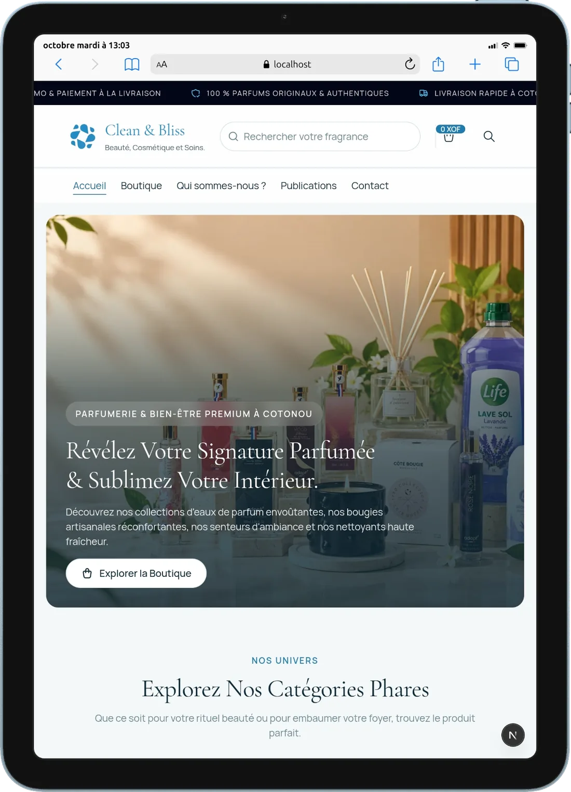
</p>

[](https://nextjs.org/)
[](https://react.dev/)
[](https://www.typescriptlang.org/)
[](https://tailwindcss.com/)
[](https://wordpress.org/)
[](https://woocommerce.com/)
[](https://www.wpgraphql.com/)
[](#licence)

</div>

---

## Sommaire

| # | Section | Contenu |
|:-:|:--|:--|
| 1 | [Aperçu](#aperçu) | Le projet en quelques lignes |
| 2 | [Pourquoi le headless ?](#pourquoi-le-headless-) | Objectif et logique de l'architecture |
| 3 | [Architecture](#architecture) | Schémas backend / frontend / flux de données |
| 4 | [Workflow de conception](#workflow-de-conception) | Les 10 étapes, de Figma au déploiement |
| 5 | [Aperçu visuel](#aperçu-visuel) | Captures desktop, tablette et mobile |
| 6 | [Stack technique](#stack-technique) | Frontend, backend, outillage |
| 7 | [Démarrage rapide](#démarrage-rapide) | Installation et lancement |
| 8 | [Variables d'environnement](#variables-denvironnement) | Configuration |
| 9 | [Scripts](#scripts-disponibles) | Commandes du projet |
| 10 | [Structure du projet](#structure-du-projet) | Arborescence commentée |
| 11 | [Design system](#design-system) | Tokens et principes visuels |
| 12 | [État d'avancement](#état-davancement) | Ce qui est livré, en cours, prévu |
| 13 | [Auteur](#auteur) | Contact |

---

## Aperçu

**Clean & Bliss** est une maison béninoise qui réunit deux univers complémentaires : la **parfumerie fine** (eaux de parfum, brumes, bougies parfumées) et les **soins de la maison** (nettoyants écologiques, désodorisants, diffuseurs, déodorants corporels).

Ce dépôt contient uniquement la **vitrine publique** — l'interface que voient les clientes et clients. Le catalogue, les stocks, les commandes et les contenus éditoriaux restent gérés dans WordPress. Le frontend ne fait que **lire** ces données via GraphQL et les mettre en scène.

> **Le résultat recherché :** un site rapide, élégant, entièrement en français, pensé pour le mobile et les connexions réelles de Cotonou — sans sacrifier l'autonomie éditoriale de l'équipe.

---

## Pourquoi le headless ?

### Le problème

Quand une entreprise grandit, son catalogue grandit avec elle : nouvelles familles de produits, nouvelles langues, nouvelles pages éditoriales, nouvelles campagnes. Sur un site **monolithique** (un thème WordPress qui affiche tout), chaque évolution devient un chantier :

- le design et le contenu sont **imbriqués** dans le même thème ;
- la moindre refonte visuelle menace de casser le back-office ;
- les performances se dégradent à mesure que le catalogue et les extensions s'accumulent ;
- l'équipe marketing dépend du développeur pour publier, et le développeur dépend du marketing pour valider.

Pour une marque qui vend **parfums, bougies, senteurs, nettoyants et déodorants** — cinq univers aux règles d'affichage très différentes — ce modèle atteint vite ses limites.

### La réponse : découpler le contenu de sa présentation

L'architecture **headless** sépare deux responsabilités qui n'ont aucune raison de vivre dans le même code :

| Couche | Rôle | Technologie | Ce qu'elle possède |
|:--|:--|:--|:--|
| **Body** (backend) | Source de vérité métier | WordPress + WooCommerce | Produits, prix, stocks, commandes, clients, contenus |
| **Head** (frontend) | Mise en scène de l'expérience | Next.js 16 (App Router) | Pages, composants, animations, SEO, performances |

Le backend expose ses données via **GraphQL** (WPGraphQL + WooGraphQL). Le frontend les consomme côté serveur. Les deux mondes communiquent par un **contrat d'API typé**, pas par un thème partagé.

### Ce que cela change concrètement

| Bénéfice | Traduction sur ce projet |
|:--|:--|
| **Performance** | React Server Components + rendu statique/incrémental : la majorité des pages sont servies en HTML déjà rendu, sans attendre WooCommerce. |
| **SEO** | Chaque produit dispose de ses métadonnées, d'un HTML complet et d'une URL propre (`/produit/[slug]`), lisibles par les robots sans exécuter de JavaScript. |
| **Liberté de design** | L'interface est écrite en Tailwind v4 avec des tokens maison. Aucun thème WordPress à contourner, aucun `!important` défensif. |
| **Autonomie éditoriale** | L'équipe publie, modifie un prix ou crée une catégorie dans WordPress ; un webhook revalide le cache Next.js et le site se met à jour. |
| **Scalabilité** | Ajouter une famille de produits, une page éditoriale ou un canal (application mobile, borne en boutique) ne demande pas de réécrire le backend. |
| **Sécurité** | La base de données et l'administration WordPress ne sont jamais exposées au navigateur. Seul un endpoint GraphQL en lecture transite. |
| **Séparation des équipes** | Le studio gère l'expérience ; la boutique gère le commerce. Les deux avancent sans se bloquer. |

### Le cycle de publication

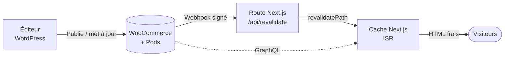

> **Limites assumées.** Le headless n'est pas gratuit : il faut héberger deux systèmes, gérer l'invalidation du cache, surveiller deux environnements et maintenir un contrat GraphQL. Ces coûts sont acceptés ici parce que le catalogue est appelé à grandir et que l'expérience de marque est un argument de vente central.

---

## Architecture

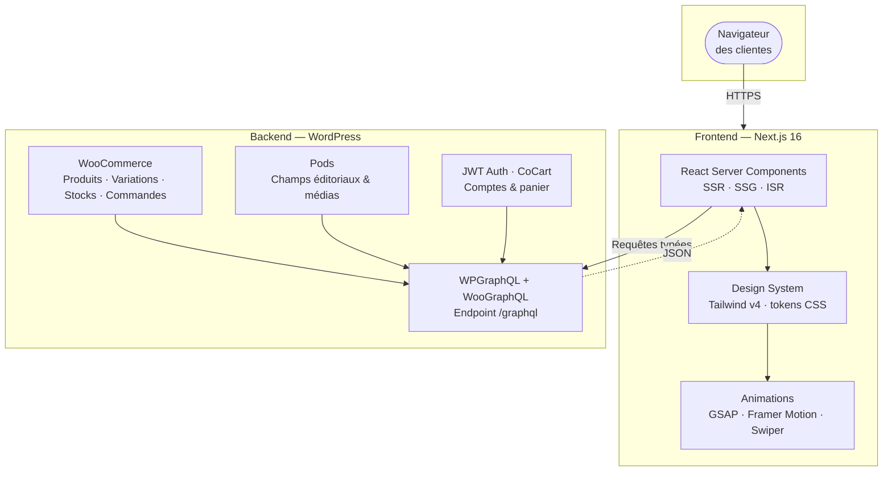

### Flux d'une fiche produit

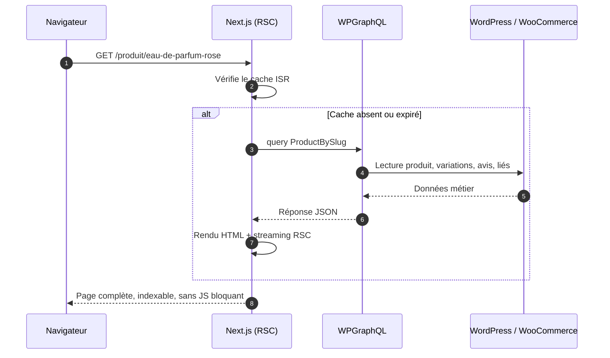

### Points d'architecture notables

| Sujet | Choix retenu |
|:--|:--|
| **Transport des données** | Un unique client `fetchGraphQL()` dans `src/lib/wp-graphql.js`, avec cache `revalidate: 3600`. |
| **Accès aux données** | Toute lecture est centralisée dans `src/lib/api/*` — les composants n'écrivent jamais de requête GraphQL. |
| **Secrets** | Aucune clé privée dans le bundle client. Les appels sensibles passent par des Route Handlers (`src/app/api/*`). |
| **Invalidation** | Webhook WordPress → `POST /api/revalidate`, protégé par `REVALIDATE_SECRET`. |
| **Images** | Optimisation `next/image`, domaines distants déclarés dans `next.config.ts`. |
| **Composants** | Server Components par défaut ; `"use client"` réservé aux îlots interactifs. |

---

## Workflow de conception

Ce projet a été mené avec une méthode reproductible : **la maquette devient une spécification, la spécification devient du code**. Chaque étape produit un livrable qui sert d'entrée à la suivante.

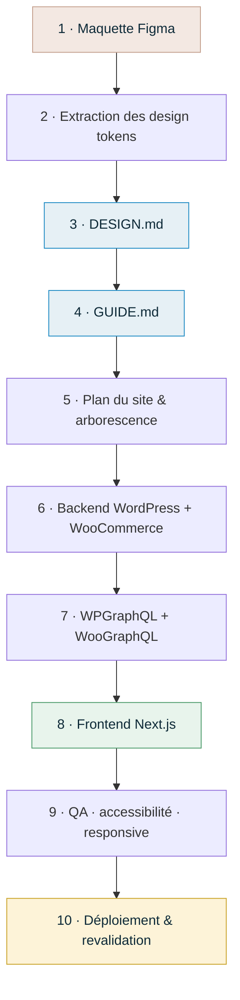

| # | Étape | Ce qui est produit | Outils |
|:-:|:--|:--|:--|
| **1** | **Maquette Figma** | Écrans desktop, tablette et mobile des 5 univers, de la boutique, de la fiche produit et des pages éditoriales. | Figma |
| **2** | **Extraction des tokens** | Couleurs, échelles typographiques, espacements, rayons, ombres, durées et courbes d'animation, relevés puis normalisés. | Figma, plugin de tokens |
| **3** | **`DESIGN.md`** | Dictionnaire du design system : rôle de chaque token, états des composants, règles d'usage. Sert de **source de vérité visuelle** aux agents IA. | Markdown |
| **4** | **`GUIDE.md`** | Spécification page par page : structure des sections, copywriting, contenus attendus, comportements. Sert de **source de vérité fonctionnelle**. | Markdown |
| **5** | **Plan du site** | Arborescence des routes, navigation, relations entre pages, règles de nommage des URL. | Markdown, diagrammes |
| **6** | **Backend WordPress** | Installation, WooCommerce, création de la boutique, catalogue produits (5 familles), variations, stocks, zones et tarifs de livraison, moyens de paiement locaux. | WordPress, WooCommerce, Local by Flywheel |
| **7** | **Couche GraphQL** | Installation et configuration de WPGraphQL, WooGraphQL, CoCart et JWT Auth ; exposition des champs Pods ; résolveurs custom ; tests dans GraphiQL. | WPGraphQL, WooGraphQL, PHP |
| **8** | **Frontend Next.js** | Design tokens dans `globals.css`, primitives UI, layout, sections de la page d'accueil, boutique filtrable, fiche produit, panier. | Next.js 16, Tailwind v4, GSAP |
| **9** | **Qualité** | Vérification TypeScript, ESLint, build de production, parcours Playwright aux largeurs 390 / 768 / 1440 / 1920 px, audit a11y et `prefers-reduced-motion`. | `tsc`, ESLint, Playwright |
| **10** | **Mise en ligne** | Build, hébergement, variables d'environnement, webhook de revalidation, surveillance. | Vercel / Node, WordPress |

### La documentation comme contrat

Le projet est piloté par cinq documents qui évitent les décisions improvisées :

| Document | Rôle | Autorité |
|:--|:--|:--|
| `src/app/globals.css` | Implémentation réelle des tokens | **1 — valeurs CSS utilisables** |
| `DESIGN.md` | Comment styler | **2 — règles visuelles** |
| `GUIDE.md` | Quoi construire | **3 — règles fonctionnelles** |
| `ANIMATIONS.md` | Comment animer | **4 — règles de mouvement** |
| `AGENTS.md` | Comment travailler | **Cadre opérationnel** |

> **Principe :** aucune couleur, aucun espacement, aucun comportement n'est inventé. Si une valeur manque, on l'arbitre et on l'ajoute au document avant de coder.

---

## Aperçu visuel

Captures réalisées sur l'application en développement, aux formats **desktop**, **tablette** et **mobile**.

### Accueil — desktop

<details>
<summary><b>Dérouler la page d'accueil complète (1920 px)</b></summary>
<br/>

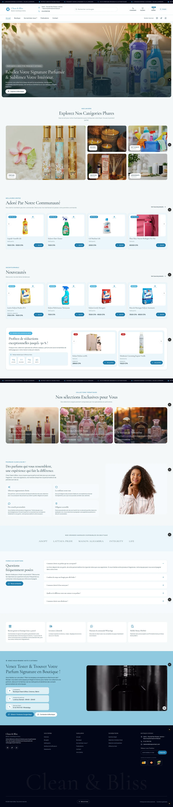

</details>

### Accueil — tablette

<table>
  <tr>
    <td align="center" width="50%">
      <br/>
      <sub><b>01</b> · Hero &amp; navigation</sub>
    </td>
    <td align="center" width="50%">
      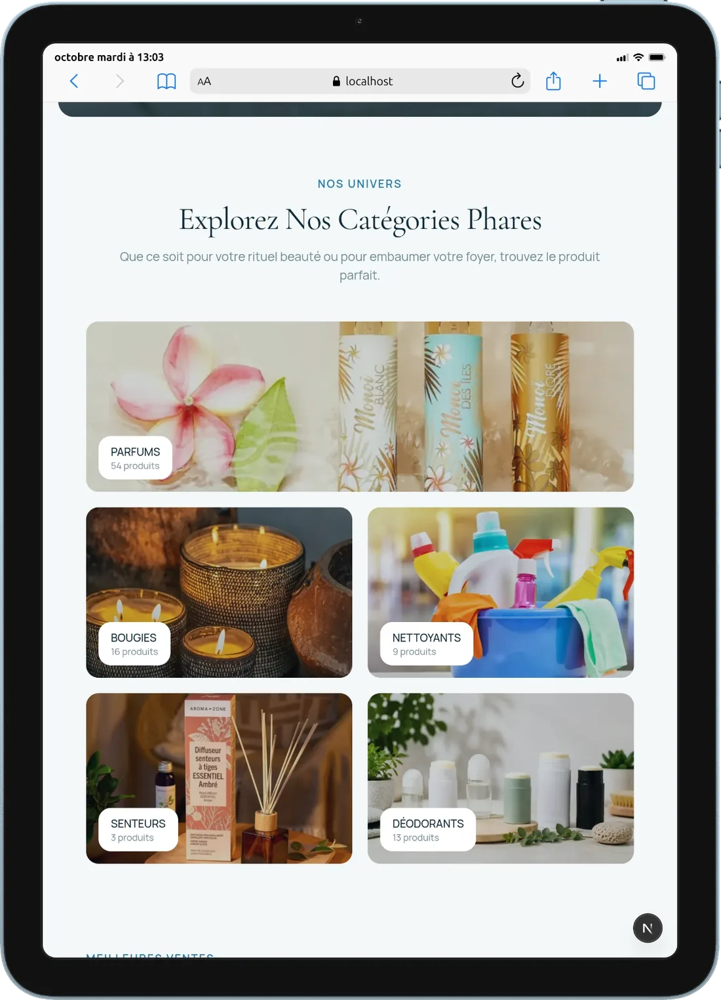<br/>
      <sub><b>02</b> · Catégories phares</sub>
    </td>
  </tr>
  <tr>
    <td align="center">
      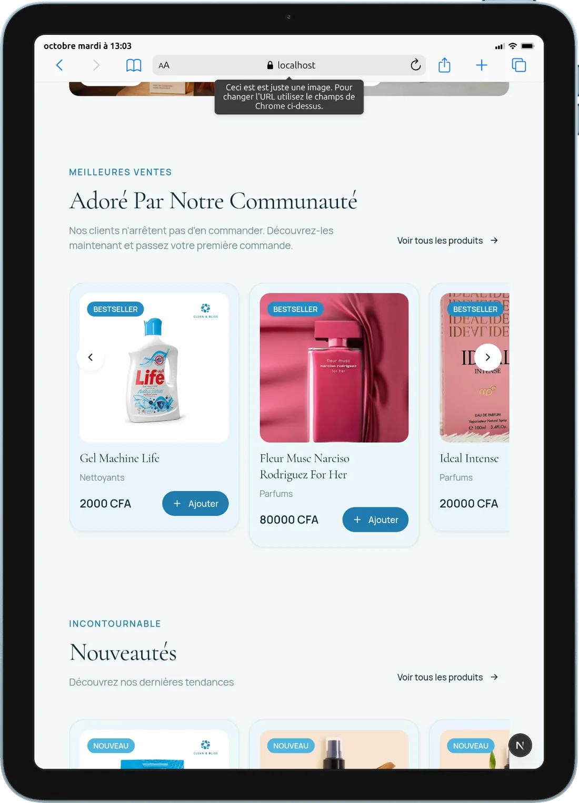<br/>
      <sub><b>03</b> · Meilleures ventes</sub>
    </td>
    <td align="center">
      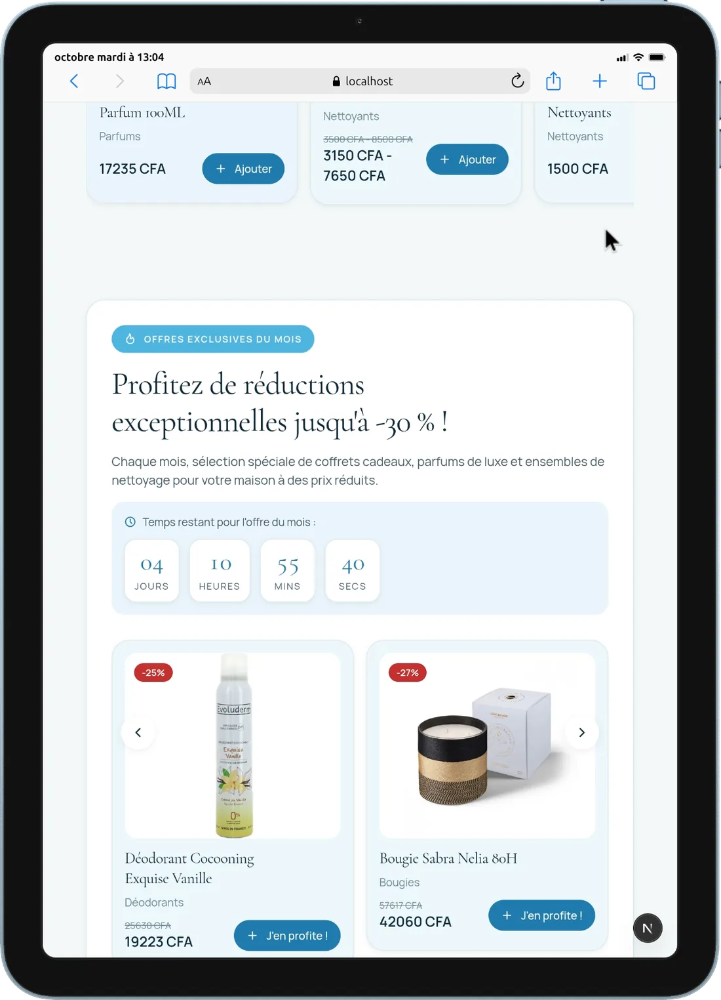<br/>
      <sub><b>04</b> · Offres &amp; compte à rebours</sub>
    </td>
  </tr>
  <tr>
    <td align="center">
      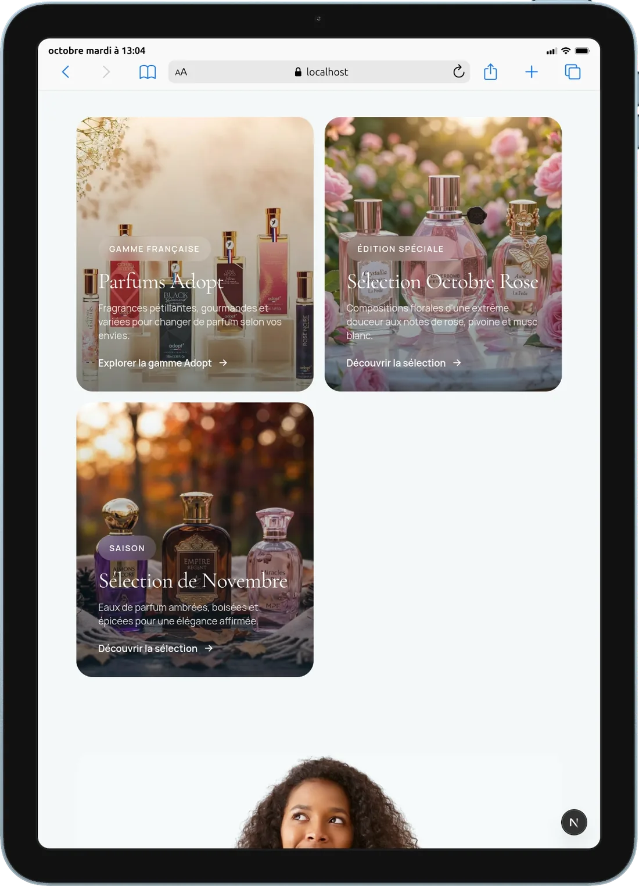<br/>
      <sub><b>05</b> · Sélections éditoriales</sub>
    </td>
    <td align="center">
      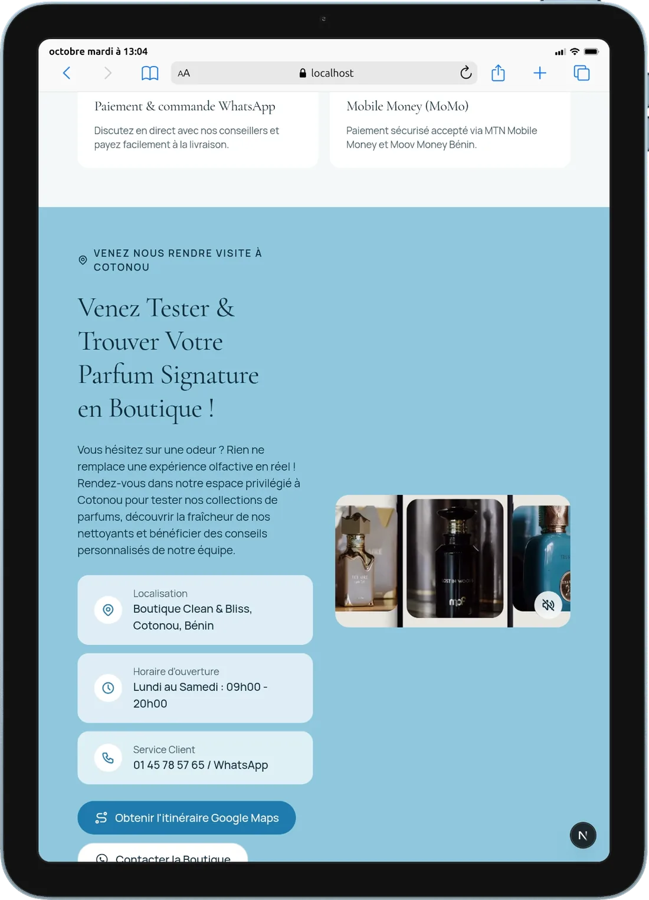<br/>
      <sub><b>06</b> · Invitation en boutique</sub>
    </td>
  </tr>
</table>

### Accueil — mobile

<table>
  <tr>
    <td align="center" width="50%">
      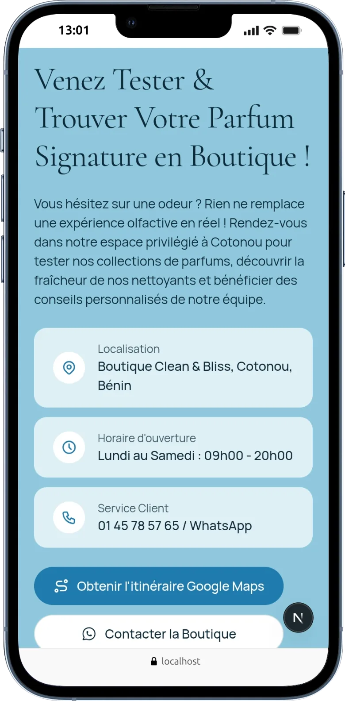<br/>
      <sub><b>01</b> · Invitation en boutique</sub>
    </td>
    <td align="center" width="50%">
      <em>Le reste de l'accueil mobile reprend les mêmes sections,<br/>réorganisées en une colonne.</em>
    </td>
  </tr>
</table>

### Boutique — desktop

<details>
<summary><b>Dérouler la page boutique complète (1920 px)</b></summary>
<br/>

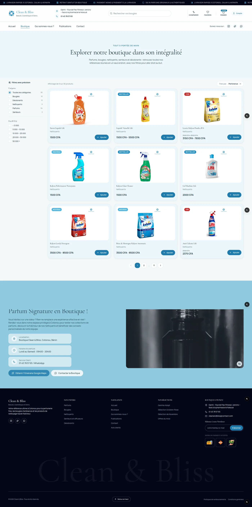

</details>

### Boutique — tablette

<table>
  <tr>
    <td align="center" width="33%">
      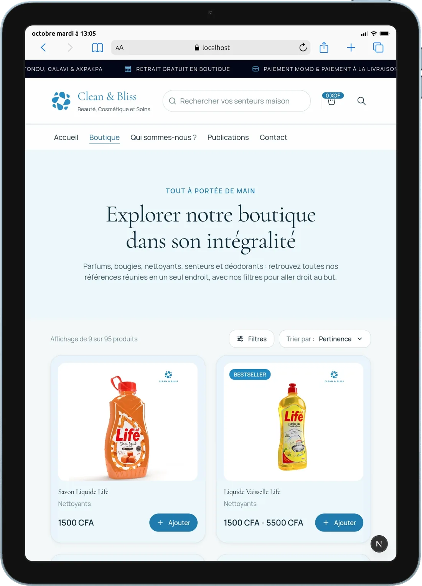<br/>
      <sub><b>01</b> · En-tête &amp; grille</sub>
    </td>
    <td align="center" width="33%">
      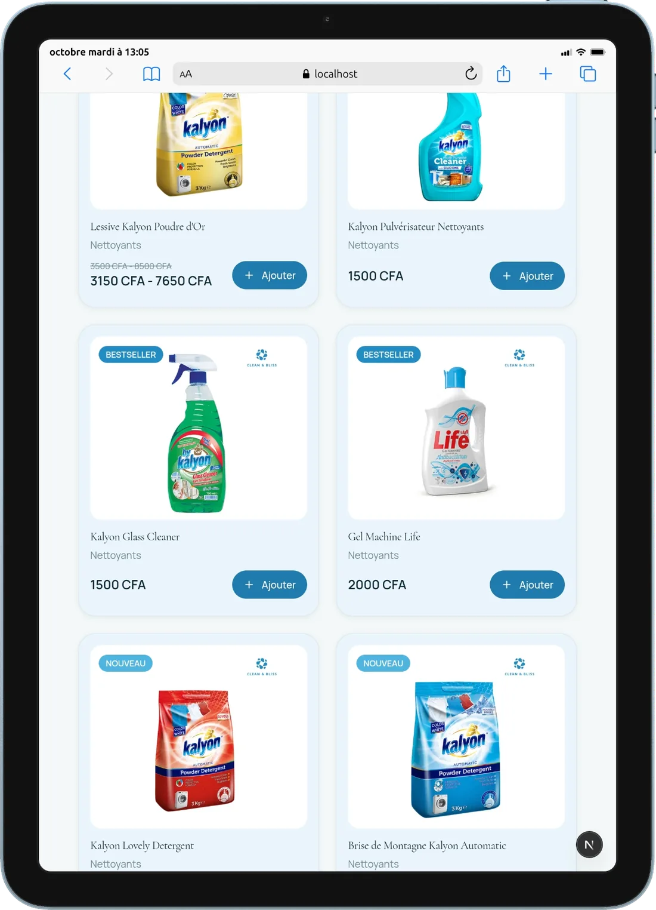<br/>
      <sub><b>02</b> · Grille produits</sub>
    </td>
    <td align="center" width="34%">
      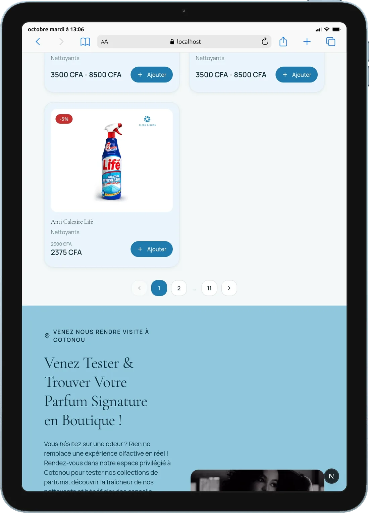<br/>
      <sub><b>03</b> · Pagination</sub>
    </td>
  </tr>
</table>

### Boutique — mobile

<table>
  <tr>
    <td align="center" width="33%">
      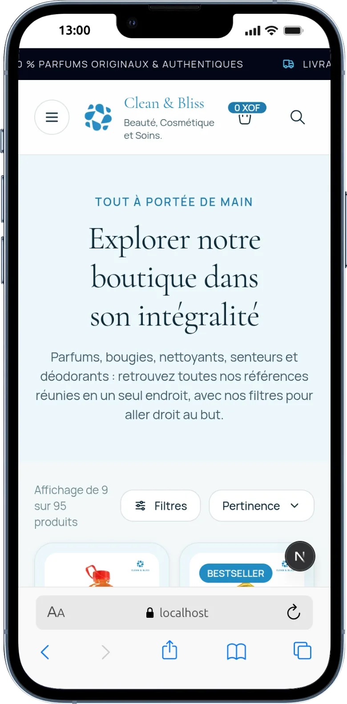<br/>
      <sub><b>01</b> · Hero</sub>
    </td>
    <td align="center" width="33%">
      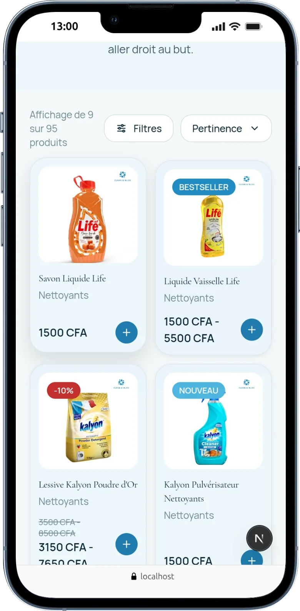<br/>
      <sub><b>02</b> · Grille 2 colonnes</sub>
    </td>
    <td align="center" width="34%">
      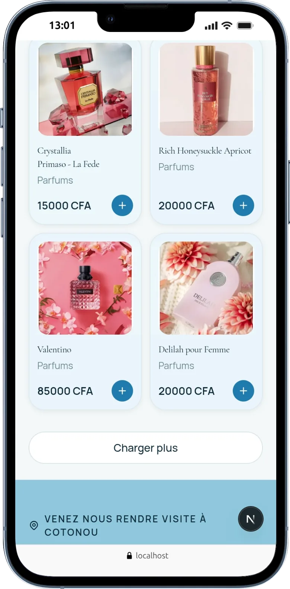<br/>
      <sub><b>03</b> · Charger plus</sub>
    </td>
  </tr>
</table>

### Footer — mobile

<table>
  <tr>
    <td align="center" width="50%">
      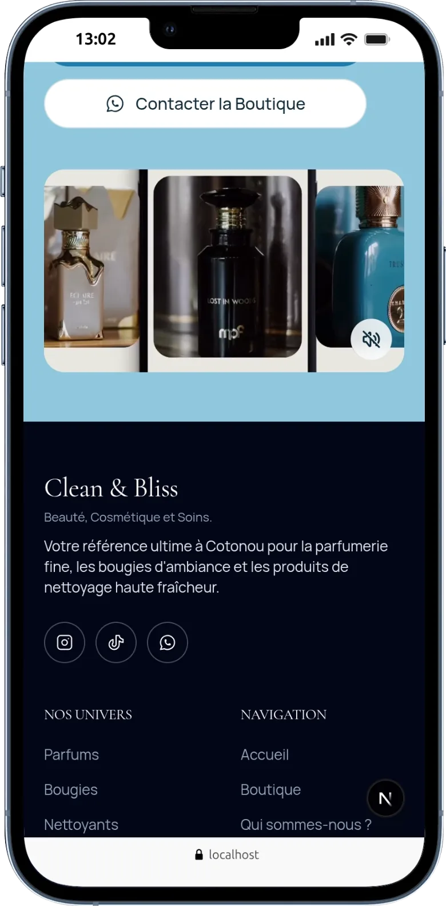<br/>
      <sub><b>01</b> · Marque &amp; navigation</sub>
    </td>
    <td align="center" width="50%">
      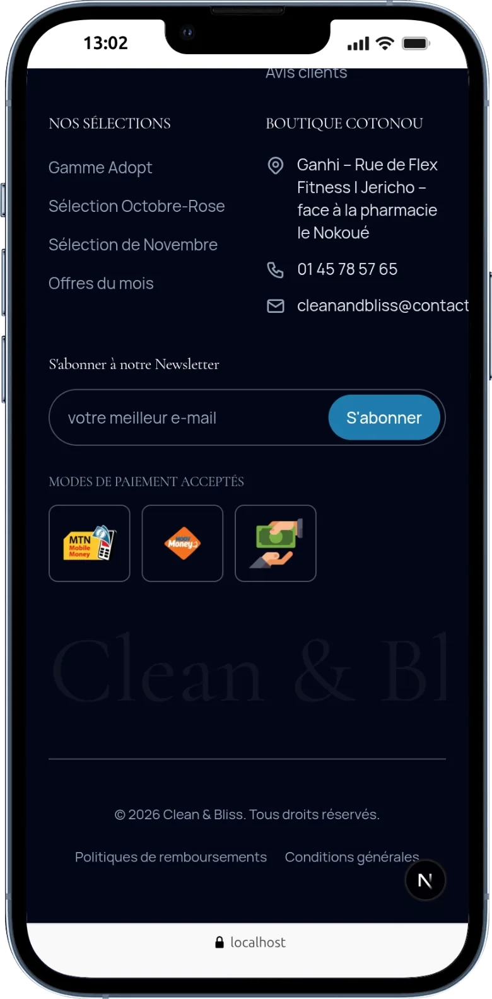<br/>
      <sub><b>02</b> · Newsletter, paiements &amp; mentions</sub>
    </td>
  </tr>
</table>

---

## Stack technique

### Frontend

| Technologie | Version | Usage |
|:--|:--|:--|
| **Next.js** | 16.3 | App Router, Server Components, ISR, Route Handlers |
| **React** | 19.2 | Rendu concurrent, streaming |
| **TypeScript** | 5 | Typage strict de bout en bout |
| **Tailwind CSS** | 4 | Utilitaires générés depuis les tokens `@theme` |
| **GSAP** | 3.15 | Révélations au scroll, timelines, `ScrollTrigger` |
| **Framer Motion** | 13 | Micro-interactions, transitions d'état |
| **Swiper** | 14 | Carrousels tactiles |
| **Radix UI** | — | Primitives accessibles (Dialog, Accordion, Radio, Dropdown) |
| **Zustand** | 5 | État client (panier, wishlist, préférences) |
| **TanStack Query** | 5 | Cache et synchronisation côté client |
| **Apollo Client** | 3 | Client GraphQL côté client |
| **Faust.js** | 3.4 | Outillage WordPress headless et authentification |
| **React Hook Form + Zod** | — | Formulaires et validation |
| **Tabler Icons** | 3.49 | Iconographie SVG |

### Backend

| Technologie | Usage |
|:--|:--|
| **WordPress** | CMS headless, pages éditoriales, médiathèque |
| **WooCommerce** | Catalogue, variations, stocks, commandes, livraison |
| **WPGraphQL** | Schéma GraphQL du contenu WordPress |
| **WooGraphQL** | Extension du schéma aux entités WooCommerce |
| **Pods** | Champs personnalisés (accueil, à propos, coordonnées) |
| **CoCart** | API panier sans session serveur |
| **JWT Auth** | Authentification des clientes |
| **Local by Flywheel** | Environnement WordPress local (`clean-and-bliss.local`) |

---

## Démarrage rapide

### Prérequis

| Outil | Version minimale |
|:--|:--|
| Node.js | ≥ 20 |
| Yarn | ≥ 1.22 |
| WordPress | Instance accessible avec WPGraphQL + WooGraphQL |

### Installation

```bash
# 1 · Cloner le dépôt
git clone https://github.com/donald-adjaho/clean-bliss-frontend.git
cd clean-bliss-frontend

# 2 · Installer les dépendances
yarn install

# 3 · Créer le fichier d'environnement
cp .env.example .env.local
# puis renseigner les URL WordPress et GraphQL

# 4 · Lancer le serveur de développement
yarn dev
```

L'application est disponible sur **[http://localhost:3000](http://localhost:3000)**.

> **Note** — Le backend WordPress doit être démarré en parallèle. En local, il est servi par Local by Flywheel sur `https://clean-and-bliss.local`. Le certificat auto-signé impose `NODE_TLS_REJECT_UNAUTHORIZED=0` **en développement uniquement**.

---

## Variables d'environnement

| Variable | Requise | Description |
|:--|:--:|:--|
| `NEXT_PUBLIC_WP_URL` | Oui | URL de base de WordPress |
| `NEXT_PUBLIC_WP_GRAPHQL_URL` | Oui | Endpoint GraphQL (`…/graphql`) |
| `FAUST_SECRET_KEY` | Oui | Clé secrète Faust.js (WP → Réglages → Faust.js) |
| `REVALIDATE_SECRET` | Oui | Secret partagé du webhook `/api/revalidate` |
| `NODE_TLS_REJECT_UNAUTHORIZED` | Dev | `0` pour accepter le certificat local auto-signé |

> Ne jamais commiter `.env.local`. Le modèle `.env.example` est conservé comme documentation.

---

## Scripts disponibles

| Commande | Effet |
|:--|:--|
| `yarn dev` | Serveur de développement (Turbopack) |
| `yarn build` | Build de production |
| `yarn start` | Serveur de production |
| `yarn lint` | Analyse ESLint |
| `npx tsc --noEmit` | Vérification des types sans émission |

---

## Structure du projet

```text
clean-bliss-frontend/
├── assets/                      # Captures d'écran du README
├── public/                      # Actifs statiques publics
├── src/
│   ├── app/                     # App Router
│   │   ├── api/revalidate/      # Webhook d'invalidation du cache
│   │   ├── boutique/            # Catalogue filtrable + skeleton
│   │   ├── produit/[slug]/      # Fiche produit + loading + 404
│   │   ├── fonts/               # Cormorant Garamond & Manrope
│   │   ├── globals.css          # Design tokens (@theme Tailwind v4)
│   │   ├── layout.tsx           # Layout racine
│   │   ├── page.tsx             # Page d'accueil
│   │   └── providers.tsx        # Providers client
│   ├── components/
│   │   ├── header/              # Bandeau, recherche, navigation, actions
│   │   ├── footer/              # Marque, colonnes, newsletter, paiements
│   │   ├── sections/            # Sections modulaires de l'accueil
│   │   ├── shop/                # Filtres, tri, grille, pagination
│   │   ├── product/             # Galerie, buybox, détails, FAQ, avis, liés
│   │   ├── shared/              # Cartes produit, carrousels, révélation
│   │   ├── ui/                  # Primitives (Button, Input, Badge, Drawer…)
│   │   └── icons/               # Icônes SVG sur mesure
│   ├── hooks/                   # useReveal, useInView, useReducedMotion…
│   └── lib/
│       ├── api/                 # Lectures WooCommerce typées
│       ├── content/             # Contenus éditoriaux statiques
│       ├── queries/             # Requêtes GraphQL de l'accueil
│       ├── cn.ts                # Fusion de classes
│       ├── format.ts            # Prix FCFA, dates, entités HTML
│       ├── shop-filters.ts      # Sérialisation des filtres d'URL
│       └── wp-graphql.js        # Client GraphQL unique
├── AGENTS.md                    # Cadre de travail des agents IA
├── next.config.ts               # Domaines d'images, options Next
├── package.json
└── tsconfig.json
```

---

## Design system

L'ensemble du style repose sur des **tokens CSS** déclarés une seule fois dans `src/app/globals.css` via la directive `@theme` de Tailwind v4. Aucun composant n'utilise de valeur brute.

| Famille | Exemples de tokens | Usage |
|:--|:--|:--|
| **Couleurs de marque** | `--color-brand-primary`, `--color-brand-accent` | Identité, accents |
| **Couleurs d'action** | `--color-action-primary`, `--color-action-on-primary` | Boutons, liens, états actifs |
| **Surfaces** | `--color-bg-surface`, `--color-bg-tint`, `--color-footer-bg` | Fonds et contrastes |
| **Texte** | `--color-text-primary`, `--color-text-secondary`, `--color-text-muted` | Hiérarchie de lecture |
| **Typographie** | `--font-heading` (Cormorant Garamond), `--font-body` (Manrope) | Titres expressifs, texte lisible |
| **Échelles de texte** | `text-h1` → `text-h6`, `text-body-l/m/s` | Cohérence éditoriale |
| **Espacements** | `--space-2xs` → `--space-5xl` | Rythme vertical et horizontal |
| **Rayons & ombres** | `--radius-sm/md/lg`, `--shadow-card`, `--shadow-card-hover` | Profondeur discrète |
| **Mouvement** | `--duration-fast/base/slow`, courbes d'easing | Animations sobres et cohérentes |

**Règles non négociables :**

- Tokens uniquement — pas de `#hex`, `px` arbitraires ni styles inline bruts.
- Primitives réutilisables dans `src/components/ui/` — jamais de bouton ou champ recodé localement.
- Accessibilité : contraste WCAG AA, `aria-label` sur les icônes, focus visible, respect de `prefers-reduced-motion`.
- Interface en français ; code, variables et commits en anglais.

---

## État d'avancement

| Périmètre | Statut |
|:--|:--:|
| Backend WordPress + WooCommerce (catalogue, stocks, livraison) | ✅ |
| WPGraphQL + WooGraphQL + CoCart + JWT | ✅ |
| Champs Pods exposés en GraphQL | ✅ |
| Design tokens & primitives UI | ✅ |
| Header (bandeau, recherche, navigation, actions) | ✅ |
| Footer (marque, colonnes, newsletter, paiements) | ✅ |
| Page d'accueil — 13 sections | ✅ |
| Boutique — filtres, tri, pagination | ✅ |
| Fiche produit — galerie, buybox, FAQ, avis, recommandations | ✅ |
| Panier & drawer panier | 🚧 |
| Tunnel de commande (Mobile Money, paiement à la livraison) | ⏳ |
| Espace client (commandes, adresses, profil) | ⏳ |
| Pages éditoriales (À propos, Contact, Publications, 404) | ⏳ |
| Wishlist, comparateur, recherche instantanée | ⏳ |

**Légende :** ✅ livré · 🚧 en cours · ⏳ planifié

---

## Auteur

**Donald Adjaho** — conception, développement frontend et intégration headless.

| Canal | Lien |
|:--|:--|
| GitHub | [@donald-adjaho](https://github.com/donald-adjaho) |
| Email | [donaldadjaho@yahoo.com](mailto:donaldadjaho@yahoo.com) |
| Projet | Clean & Bliss — Cotonou, Bénin |


<div align="center">
<br/>
<sub>Conçu avec soin à Cotonou · Next.js × WordPress</sub>
</div>